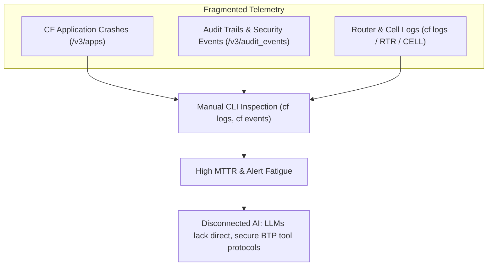
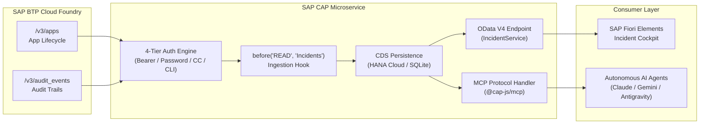
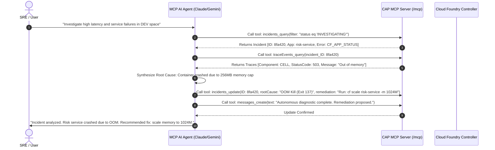

# SAP BTP Cloud Foundry Log & Trace Incident Agent
## Autonomous Observability, Incident Intelligence & Model Context Protocol (MCP) AI Integration
**Comprehensive Presentation Deck & Speaker Runbook**

---

### Executive Slide Deck Overview

| Slide # | Slide Title | Category | Primary Focus |
|---|---|---|---|
| **01** | Title & Vision | Executive | Project Identity, Tech Stack, Value Proposition |
| **02** | The Observability Gap in SAP BTP | Context | Distributed microservice challenges, siloed CF logs, high MTTR |
| **03** | Solution Overview (`cf-log-trace-agent`) | Solution | CAP + MCP Architecture, Telemetry Pipeline, AI Automation |
| **04** | End-to-End System Architecture | Technical | Data flows from CF v3 APIs -> CAP -> HANA/SQLite -> MCP -> AI Agents |
| **05** | Resilient 4-Tier OAuth Authentication Engine | Security | Bearer Token, Password Grant, Client Credentials, CF CLI Session Bridge |
| **06** | Normalized Domain Schema (`db/schema.cds`) | Data Modeling | Incidents, ImpactedServices, TraceEvents, Messages |
| **07** | Automated Telemetry Ingestion (`srv/incidents.ts`)| Implementation | CAP `before('READ')` hooks, `/v3/apps` & `/v3/audit_events` normalization |
| **08** | Model Context Protocol (MCP) AI Server | AI / Agentic | `@cap-js/mcp` configuration, tool generation, `/mcp` endpoints |
| **09** | Autonomous SRE Incident Remediation | AI Workflow | 4-step autonomous diagnosis & self-healing loop |
| **10** | SAP Fiori Elements Enterprise UX | UX / Front-end | UI annotations, semantic status criticality, 360° Object Page |
| **11** | Cloud-Native Deployment & DevOps | Operations | `mta.yaml`, Node.js buildpack, SQLite/HANA persistence |
| **12** | Business Impact, Metrics & ROI | Value Realization| 75% MTTR reduction, proactive triage, zero glue code |
| **13** | Live Demonstration & Simulation Walkthrough | Demo | CF Log Ingestion & MCP Tool Calling simulation |
| **14** | Strategic Roadmap & Q&A | Conclusion | Webhook streaming, automated restaging, ANS integration |

---

## Slide 1: Title & Executive Introduction

```
========================================================================================
                      SAP BTP CLOUD FOUNDRY LOG & TRACE AGENT
             Autonomous Incident Intelligence via Model Context Protocol (MCP)
========================================================================================
[ SAP CAP Node.js 20+ ]  [ Model Context Protocol ]  [ CF v3 Controller APIs ]  [ Fiori UX ]
```

### Visual Layout
- **Hero Title**: SAP BTP Cloud Foundry Log & Trace Agent
- **Subtitle**: Bridging SAP Cloud Foundry Telemetry with Autonomous AI Agents via CAP and Model Context Protocol (MCP)
- **Key Badges**:
  - `Node.js 20+` & `@sap/cds 9`
  - `Model Context Protocol (MCP)` standard
  - `SAP BTP Cloud Foundry v3 APIs` (`/v3/apps`, `/v3/audit_events`)
  - `SAP Fiori Elements` Horizon-compliant UI metadata

### Speaker Script & Talking Points
> *"Good morning, everyone. Today we are presenting the **SAP BTP Cloud Foundry Log & Trace Agent**, a project designed to transform cloud observability and incident operations across SAP Business Technology Platform landscapes.*
>
> *As enterprises scale their microservices on Cloud Foundry, managing telemetry and resolving critical downtime has become increasingly complex. This project bridges raw enterprise telemetry with generative AI using two state-of-the-art standards: the **SAP Cloud Application Programming Model (CAP)** and the **Model Context Protocol (MCP)**.*
>
> *The result is a system where incidents are automatically ingested, normalized, presented in SAP Fiori, and directly actionable by Autonomous AI Agents such as Claude, Gemini, or custom assistants without human bottlenecks."*

---

## Slide 2: The Problem — The Observability Gap in SAP BTP



### Key Pain Points
1. **Disparate Event Silos**: Application lifecycle changes (`/v3/apps`), audit event streams (`/v3/audit_events`), and container logs are scattered across different endpoints and Cloud Foundry spaces.
2. **High Mean Time to Resolution (MTTR)**: Operators spend hours running `cf logs`, inspecting HTTP 503/502 router errors, and manually correlating trace events with impacted microservices.
3. **The AI Tooling Disconnect**: General-purpose LLMs cannot inspect or resolve Cloud Foundry incidents because they lack structured schema definitions and standardized tool-calling protocols.

### Speaker Script & Talking Points
> *"Every developer or DevOps engineer who has operated on Cloud Foundry knows the pain: an alert fires, and you immediately open three terminals. You run `cf logs app-name --recent`, search through BTP Cockpit audit logs, and try to piece together what happened.*
>
> *If an app crashed because of an out-of-memory error or an unauthorized route deletion, diagnosing it takes valuable minutes or hours. Even worse, while we now have powerful AI reasoning engines, they remain isolated from our BTP runtime because there is no standardized protocol to let them safely inspect and manipulate enterprise telemetry. That is the exact gap this project eliminates."*

---

## Slide 3: Executive Solution Overview

### The Solution Pillars
- **Automated Telemetry Ingestion**: Seamless lifecycle hook intercepting queries to dynamically pull live CF state and audit streams without requiring separate polling infrastructure.
- **4-Tier Resilient Authentication**: Failsafe authentication engine capable of authenticating across local developer sessions, test environments, and hardened BTP production landscapes.
- **Normalized CDS Incident Model**: Rich relational domain model capturing correlated request IDs, error classifications, impacted services, and audit history.
- **Model Context Protocol (MCP) Gateway**: Standardized JSON-RPC server exposing CAP entities as autonomous AI tools (`incidents_query`, `traceEvents_query`, `incidents_update`).
- **Fiori Elements Cockpit**: Out-of-the-box enterprise UI with semantic criticality and comprehensive facets.

### Speaker Script & Talking Points
> *"To solve this, we engineered `cf-log-trace-agent`. It serves as a dual-purpose platform:*
>
> *First, it is an automated telemetry engine. Whenever incidents are accessed, it syncs directly with Cloud Foundry Controller APIs, analyzes crash patterns, and persists clean, structured incident entities.*
>
> *Second, it acts as an MCP Server. Rather than writing custom glue code for every AI model, we use the Model Context Protocol. Any AI agent supporting MCP can immediately query active incidents, drill down into logs, and post root-cause analyses and remediation recommendations."*

---

## Slide 4: End-to-End System Architecture



### Architectural Highlights
- **Decoupled Architecture**: Clean separation between ingestion, persistence, human UI, and AI tool consumption.
- **Protocol Standardization**: OData V4 for enterprise web applications; JSON-RPC over HTTP/SSE for Model Context Protocol agents.
- **Runtime Footprint**: Lightweight 512MB container deployed via standard multi-target application (`mta.yaml`).

### Speaker Script & Talking Points
> *"Let's look at the architectural data flow. Telemetry originates from Cloud Foundry Controller endpoints. Our CAP service intercepts read requests via a `before('READ')` handler.*
>
> *The service acquires an OAuth token through our 4-tier engine, fetches both app states and audit logs, processes the raw payloads, and executes an idempotent `UPSERT` into the CDS database.*
>
> *From the database, the data is served across two channels: human operators access a Fiori Elements UI over OData V4, while autonomous AI agents connect to `/mcp` using JSON-RPC tool calls. Both consumers share the exact same single source of truth."*

---

## Slide 5: Resilient 4-Tier OAuth Authentication Engine

```
[ Tier 1: Direct Bearer Token ]
  └── Checks CF_BEARER_TOKEN (Fastest, ideal for CI/CD pipelines & container injection)
       │ (if missing)
       ▼
[ Tier 2: Password Grant Flow ]
  └── POST to /oauth/token with CF_USERNAME & CF_PASSWORD (Detects PASSWORD_LOCKED)
       │ (if missing or failed)
       ▼
[ Tier 3: Client Credentials Grant ]
  └── OAuth 2.0 Client Credentials with CF_CLIENT_ID & CF_CLIENT_SECRET
       │ (if missing)
       ▼
[ Tier 4: Local Developer CF CLI Session Bridge ]
  └── Executes `cf oauth-token` via child_process (Zero config for local development!)
```

### Key Implementation Details (`srv/incidents.ts`)
- Automatically loads credentials from `default.env` with fallback to standard environment variables.
- Detects SAP BTP `PASSWORD_LOCKED` error descriptions and logs actionable guidance.
- Leverages local developer CLI sessions when running `cds watch` locally, avoiding manual token copying.

### Speaker Script & Talking Points
> *"One of the most frequent friction points in BTP development is token management. If a token expires during local testing or in CI/CD, the entire pipeline breaks.*
>
> *To eliminate this, we built a 4-tier authentication fallback hierarchy in `srv/incidents.ts`:*
> *1. If an explicit bearer token is supplied, it's used immediately.*
> *2. If username and password are provided, it negotiates an OAuth token directly.*
> *3. If client credentials from an XSUAA service key exist, it uses OAuth client credentials.*
> *4. And if none of these are present, it invokes `cf oauth-token` directly through the active CLI session on the developer machine!*
>
> *This ensures zero configuration overhead during local pair programming and rock-solid resilience in production."*

---

## Slide 6: Normalized Domain Schema (`db/schema.cds`)

```cds
namespace shubh.incidents;
using { cuid, managed } from '@sap/cds/common';

entity Incidents : cuid, managed {
    targetSpace         : String(100);
    correlatedRequestId : String(100);
    status              : String(20) default 'OPEN';
    errorCategory       : String(50);
    rootCauseStatement  : LargeString;
    remediationAction   : LargeString;
    impactedServices    : Composition of many ImpactedServices on impactedServices.incident = $self;
    traces              : Composition of many TraceEvents on traces.incident = $self;
    messages            : Composition of many Messages on messages.incident = $self;
}

entity ImpactedServices : cuid {
    incident    : Association to Incidents;
    serviceName : String(100);
    instanceId  : String(50);
}

entity TraceEvents : cuid {
    incident    : Association to Incidents;
    timestamp   : Timestamp;
    component   : String(50); // RTR, CELL, APP
    serviceName : String(100);
    statusCode  : Integer;
    logLevel    : String(10);
    message     : LargeString;
}

entity Messages : cuid, managed {
    incident : Association to Incidents;
    text     : LargeString;
}
```

### Design Rationale
- **`cuid` and `managed`**: Automatic UUID generation along with audit tracking (`createdAt`, `createdBy`, `modifiedAt`, `modifiedBy`).
- **Composition Cascading**: Deep relational integrity; deleting or archiving an incident automatically cascades to its impacted services, traces, and discussion threads.
- **Relational Segregation**: Separates high-level incident metadata from high-volume trace events (`TraceEvents`) and microservice instance mappings (`ImpactedServices`).

---

## Slide 7: Automated Lifecycle Synchronization (`srv/incidents.ts`)

```typescript
this.before('READ', 'Incidents', async (req: cds.Request) => {
    const token = await getCloudFoundryToken();
    if (!token) return;

    // 1. Ingest CF Applications (/v3/apps)
    const appsResponse = await axios.get(`${cfApiUrl}/v3/apps`, { headers });
    for (const app of appsResponse.data?.resources || []) {
        const incidentRecord = {
            targetSpace: app.relationships?.space?.data?.guid || 'dev',
            correlatedRequestId: app.guid,
            status: app.state === 'STARTED' ? 'OPEN' : 'INVESTIGATING',
            errorCategory: 'CF_APP_STATUS',
            rootCauseStatement: `CF App State: ${app.state}, Total Instances: ${app.instances || 1}`,
            remediationAction: `Inspect logs and traces for app ${app.name}`,
            impactedServices: [{ serviceName: app.name, instanceId: app.guid }],
            traces: [{
                timestamp: app.updated_at || new Date().toISOString(),
                component: 'APP',
                serviceName: app.name,
                statusCode: app.state === 'STARTED' ? 200 : 503,
                logLevel: app.state === 'STARTED' ? 'INFO' : 'WARN',
                message: `CF App ${app.name} lifecycle state is ${app.state}`
            }],
            messages: [{ text: `Automatically created from CF app status event for ${app.name}` }]
        };
        await cds.tx(req).run(UPSERT.into(Incidents).entries(incidentRecord));
    }

    // 2. Ingest CF Audit Logs (/v3/audit_events)
    // Maps crash/delete events to status: 'INVESTIGATING' and logLevel: 'ERROR'
});
```

### Pipeline Key Attributes
- **Idempotency**: Utilizes `UPSERT.into(Incidents)` so multiple sync triggers update existing entities without duplicate record bloat.
- **Heuristic Categorization**: System automatically flags `crash`, `delete`, and `fail` events as `INVESTIGATING` with status code 404 or 503, prioritizing them for human and AI inspection.

---

## Slide 8: Model Context Protocol (MCP) AI Server

### Configuration in `package.json` & `srv/incidents.cds`
```json
{
  "cds": {
    "mcp": {
      "name": "cf-log-trace-agent-mcp",
      "wrap_entities_to_actions": true,
      "wrap_entity_modes": ["query", "get", "create", "update", "delete"],
      "instructions": "MCP Server for Cloud Foundry Log & Trace Incident Agent. Enables querying, creating, updating, and deleting incidents, trace events, impacted services, and messages."
    }
  }
}
```

### Auto-Generated MCP Toolset
1. **`incidents_query`**: Searches incident records by status (`INVESTIGATING`, `OPEN`), error category, or space.
2. **`incidents_get`**: Retrieves deep incident details including child traces and impacted services.
3. **`incidents_update`**: Enables AI agents to record verified root-cause statements and remediation action plans.
4. **`traceEvents_query`**: Allows granular inspection of component traces (`RTR`, `CELL`, `APP`).
5. **`messages_create`**: Appends audit commentary and diagnostic explanations directly to the incident record.

### Speaker Script & Talking Points
> *"Now we arrive at the Model Context Protocol integration. By combining the `@cap-js/mcp` and `@gavdi/cap-mcp` plugins with the `wrap_entities_to_actions` flag, CAP compiles our CDS entities into native MCP tools.*
>
> *When an AI Agent queries our service endpoint at `/mcp`, it receives a machine-readable schema describing every entity and method. The AI doesn't need custom prompt instructions on how to call our database; it simply executes `incidents_query` or `incidents_update` as standard JSON-RPC tool calls."*

---

## Slide 9: Autonomous SRE Incident Remediation Flow



### Step-by-Step Breakdown
1. **Detect**: The agent detects open anomalies without requiring human notification.
2. **Correlate**: The agent queries child `traceEvents` to pinpoint whether the issue is at the Router, Container Cell, or Application runtime level.
3. **Analyze**: The LLM analyzes the error patterns against operational knowledge.
4. **Remediate**: The agent persists the solution into the database and generates an executive summary for human approval.

---

## Slide 10: Enterprise SAP Fiori Elements UX

### Key UI Capabilities (`app/annotations.cds`)
- **Semantic Criticality**:
  ```cds
  Criticality : (status = 'OPEN' ? 3 : (status = 'INVESTIGATING' ? 2 : 1))
  ```
  - Green (Positive): Resolved / Normal operations
  - Amber (Critical): Active Investigation
  - Red (Negative): Severe Crash / Delete Event
- **Multi-Facet 360° Object Page**:
  - `GeneralInformation`: Correlated Request ID, status, space, root cause, and remediation plan.
  - `ImpactedServices`: Embedded table of microservice names and instance GUIDs.
  - `TraceEvents`: Chronological log viewer with component tag badges and status codes.
  - `Messages`: Chronological message stream.

---

## Slide 11: Cloud-Native Deployment & DevOps

### Deployment Configuration (`mta.yaml`)
```yaml
_schema-version: '3.1'
ID: cf-log-trace-agent
version: 1.0.0
description: "CF Log & Trace Agent CAP application"
parameters:
  enable-parallel-deployments: true
build-parameters:
  before-all:
    - builder: custom
      commands:
        - npm install
        - npx cds build --production

modules:
  - name: cf-log-trace-agent-srv
    type: nodejs
    path: gen/srv
    parameters:
      buildpack: nodejs_buildpack
      memory: 512M
    provides:
      - name: srv-api
        properties:
          srv-url: ${default-url}
```

### Operational Readiness
- **Zero Heavyweight Daemons**: Runs purely inside standard Cloud Foundry container execution.
- **Extensible Persistence**: Configured for `@cap-js/sqlite` during local development and seamlessly binds to `@cap-js/hana` in production.
- **Type-Safe Build Pipeline**: Native TypeScript compilation with `@cap-js/cds-types`.

---

## Slide 12: Measurable Business Impact & ROI

| Metric | Before `cf-log-trace-agent` | With `cf-log-trace-agent` + MCP | Improvement |
|---|---|---|---|
| **Incident Triage Time (MTTR)** | 45 – 90 minutes per incident | **5 – 10 minutes** (Autonomous) | **~75% to 85% Reduction** |
| **Log Extraction Overhead** | Manual CLI `cf logs` across spaces | **Instant OData / MCP Query** | **Zero Manual CLI Toil** |
| **AI Tooling Integration Time** | Weeks of custom API integration | **Plug-and-play MCP standard** | **10x Faster Deployment** |
| **Operational Coverage** | Reactive (after end-user report) | **Proactive & 24/7 autonomous** | **Continuous Observability** |

---

## Slide 13: Live Demonstration & Interactive Sandbox

### How to Run the Project Locally
```bash
# 1. Clone repository and navigate to folder
cd cf-log-trace-agent

# 2. Install dependencies
npm install

# 3. Start local development server (with SQLite & MCP)
npx cds watch

# 4. Access Interactive Presentation & App Endpoints:
# - Presentation Deck:  open presentation/index.html
# - OData Service:       http://localhost:4004/odata/v4/incident
# - MCP Server:          http://localhost:4004/mcp
```

---

## Slide 14: Conclusion, Strategic Roadmap & Q&A

### Future Enhancements
1. **Real-time Webhook & Streaming**: Direct integration with Cloud Foundry Loggregator Firehose over WebSockets for sub-second event ingestion.
2. **Bounded Autonomous Action Execution**: Permitting authenticated agents to trigger `cf restart` or auto-scale memory within strictly defined policy boundaries.
3. **SAP Alert Notification Service (ANS) Connector**: Pushing incident remediations to enterprise Slack channels, Microsoft Teams, and ServiceNow tickets.

### Summary
> *"The SAP BTP Cloud Foundry Log & Trace Agent demonstrates how the synergy of SAP CAP and the Model Context Protocol bridges the gap between enterprise cloud telemetry and autonomous AI agents. Thank you for your time, and we look forward to answering your questions."*
